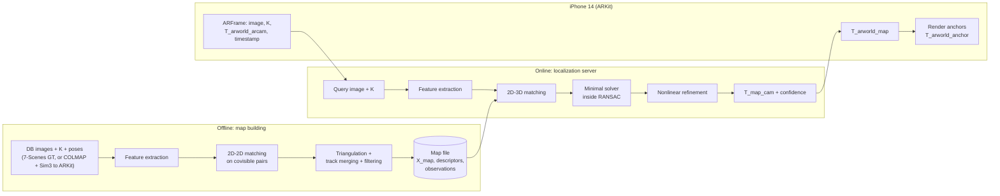

# Anchor — Architecture

Anchor maps a space once, saves the map, and later recovers the 6DoF pose of a single new camera image inside it. That pose lets virtual content placed in one session reappear in the same physical spot in a later session.

This document describes what each part of the system does, what it consumes and produces (with frames and units), which problems have to be solved inside it, how it fails, and how you know it works. It deliberately contains no implementation for the relocalization core (Steps 3–5).

Items marked **⚠ verify** are details about datasets, libraries, or APIs that I'm not certain are current or exact. Check them against the source before relying on them.

---

## 0. Conventions (read first, enforce everywhere)

### 0.1 Transform notation

- `T_a_b` is an SE(3) transform that maps points expressed in frame `b` into frame `a`: `p_a = T_a_b · p_b`.
- Composition chains on matching inner subscripts: `T_a_c = T_a_b · T_b_c`.
- Inversion swaps subscripts: `T_b_a = T_a_b⁻¹`.
- `T_world_cam` is the camera's pose in the world, also called camera-to-world. Its translation column is the camera center in world coordinates.
- `T_cam_world` is the extrinsic matrix, also called world-to-camera. It is what PnP solves for, because it is what appears in the projection equation `x ~ K [R | t] X_world`.

**Camera center vs. the `t` of `T_cam_world`.** The camera center is `c_world = −Rᵀt`, not `t`. Reporting `‖t_est − t_gt‖` from `T_cam_world` as "translation error" is a common bug. That quantity mixes rotation error into translation error.

### 0.2 Frames used in this system

| Frame | Definition | Origin / axes |
|---|---|---|
| `cam` | Camera optical frame, **OpenCV convention** | x right, y down, z forward (along the optical axis) |
| `map` | Frame the saved map is expressed in | For 7-Scenes: the dataset's world frame. For own rooms: gravity-aligned and metric after Sim(3) alignment to ARKit (§6.3) |
| `arworld` | ARKit session world frame | Origin at session start; **+y opposite gravity**; resets when a session resets |
| `arcam` | ARKit camera frame | x right, **y up, z backward** (OpenGL-style) |
| `body` | EuRoC IMU/body frame | GT poses are given for this frame, not the camera (§2.3) |
| `anchor_i` | A piece of placed content | Stored as `T_map_anchor_i` |

`T_arcam_cam = diag(1, −1, −1)` as a rotation, with zero translation. It converts the OpenCV camera frame into the ARKit camera frame. **⚠ verify** this against a live device, as described in §9.4.

### 0.3 Units and numeric types

- Lengths are in **meters** and angles are in **radians** internally. Degrees and centimeters appear only in reports.
- Use float64 for all geometry on the server. The phone uses float32 (`simd_float4x4`). At room scale (~10 m), float32 relative precision of ~1e-7 gives ~1 µm, which is irrelevant here.
- Rotations are stored as 3×3 matrices internally. Quaternions exist only at I/O boundaries, and their component order differs per source:

| Source | Quaternion order | Pose direction |
|---|---|---|
| TUM RGB-D groundtruth | `qx qy qz qw` | `T_world_cam` |
| EuRoC `state_groundtruth_estimate0` | `qw qx qy qz` | `T_world_body` |
| COLMAP `images.bin/txt` | `qw qx qy qz` | **`T_cam_world`** |
| 7-Scenes `*.pose.txt` | 4×4 matrix | `T_world_cam` **⚠ verify** |
| ARKit `ARFrame.camera.transform` | 4×4 `simd_float4x4`, **column-major** | `T_arworld_arcam` |
| SciPy `Rotation.from_quat` | `x y z w` (scalar-last default) | — |

Every loader converts to a single internal type (your `SE3`) at the boundary. Every loader also gets a round-trip test against a known pose.

### 0.4 Pixel conventions

- **OpenCV** puts the center of the top-left pixel at `(0, 0)`.
- **COLMAP** puts the top-left image *corner* at `(0, 0)`, so the center of the top-left pixel is `(0.5, 0.5)`. The principal point therefore differs by 0.5 px between the two. Convert at the COLMAP import boundary.
- **Resizing an image changes K.** With scale factor `s` and pixel-center coordinates: `fx' = s·fx`, `fy' = s·fy`, `cx' = s·(cx + 0.5) − 0.5`, `cy' = s·(cy + 0.5) − 0.5`.
- Rotating an image by 90° (e.g. phone portrait vs. sensor-native landscape) swaps and reflects K's entries. Prefer to never rotate the image. Process it in sensor orientation with the intrinsics ARKit reports for that orientation.

---

## 1. System overview



### 1.1 Step map

Steps 3–5 are the **carve-out**: you implement these yourself. OpenCV's versions are allowed only as test oracles, never inside the pipeline.

| Step | Component | Status | Owner |
|---|---|---|---|
| 1 | Geometry foundations: camera model, SO(3)/SE(3), synthetic scenes | Done | Foundation |
| 2 | Dataset loaders + evaluation harness | TUM done. 7-Scenes, EuRoC, and relocalization metrics remain | Foundation |
| 3 | Feature extraction + matching (2D-2D and 2D-3D) | — | **You (carve-out)** |
| 4 | Absolute pose: minimal solver + RANSAC | — | **You (carve-out)** |
| 5 | Pose refinement (nonlinear least squares on SE(3)) | — | **You (carve-out)** |
| 6 | Map building (triangulation from known poses, COLMAP import) + persistence | — | Not carve-out. High signal, so recommended you write the triangulation |
| 7 | End-to-end localization + benchmarks + failure analysis | — | You drive; baseline runners are foundation |
| 8 | Server + iOS client + AR alignment + rendering | — | Mixed |

**Order rationale.** Steps 3–5 can be developed and tested before any map exists. Use Step 1's synthetic scenes first. Then use TUM depth as real 3D points, as described in §4.5. That puts the hardest learning first and keeps the map-building work from blocking it.

---

## 2. Technology stack

| Layer | Choice | Role / notes |
|---|---|---|
| Language | Python 3.11+ | Server and research code |
| Numerics | NumPy | All geometry |
| Vision primitives | OpenCV ≥ 4.4 (`cv2.SIFT_create` is in main since the patent expiry) **⚠ verify current version** | Image I/O, detectors/descriptors. `solvePnP`, `solvePnPRansac`, and `triangulatePoints` are used **only as test oracles** |
| ANN search | `cv2.FlannBasedMatcher` (KD-tree for SIFT, LSH for ORB) or FAISS | Map-side descriptor index |
| SfM for own rooms | COLMAP (CLI) and/or `pycolmap` **⚠ verify API** | Produces the initial model; you import it |
| Storage | HDF5 (`h5py`) or `.npz` | Map file (§6.4) |
| Testing | `pytest` | Includes property tests on synthetic data |
| Plotting | Matplotlib | Reports |
| Server | FastAPI + Uvicorn | `/localize` endpoint |
| Baselines | ORB-SLAM3 (C++, run in Docker), hloc **⚠ verify current maintenance/API** | §7.4 |
| iOS | Swift, ARKit (`ARWorldTrackingConfiguration`), RealityKit or SceneKit, Xcode | iPhone 14: **no LiDAR**, so monocular only |
| Device deploy | Free Apple developer account works. Free provisioning profiles expire after ~7 days **⚠ verify** | Re-sign periodically |

---

## 3. Step 2 (remaining): datasets and evaluation harness

### 3.1 Datasets and what each is for

| Dataset | Used for | Key facts |
|---|---|---|
| **7-Scenes** (Shotton et al., CVPR 2013) | **Primary relocalization benchmark** | 7 indoor scenes: Chess, Fire, Heads, Office, Pumpkin, RedKitchen, Stairs. Kinect v1, 640×480 RGB-D. Official train/test sequence splits per scene. GT from KinectFusion |
| **TUM RGB-D** | ATE/RPE on trajectories; real-data unit tests for Steps 3–5 via depth | Loader done. Depth PNG scale = 5000 per meter. fr1 has nonzero distortion |
| **EuRoC MAV** | ATE/RPE; cross-session relocalization within one room | 752×480 grayscale stereo (use `cam0`), radial-tangential distortion, GT in body frame |
| Own captures (iPhone 14) | Conditions benchmark: lighting, viewpoint, occlusion | Recorded by the iOS capture mode (§9.2) |

### 3.2 7-Scenes problems to solve

- **Intrinsics.** The dataset does not ship a calibrated RGB K in an obvious place. Most published work assumes f ≈ 525 px with the principal point at the image center. **⚠ verify** which value the methods you compare against used, and use the same one.
- **RGB–depth registration.** The Kinect RGB and depth streams are not perfectly registered. This is one reason to build the map by triangulating RGB features (§6.2) rather than unprojecting depth.
- **Pseudo ground truth.** Brachmann et al. (ICCV 2021, "On the Limits of Pseudo Ground Truth in Visual Camera Re-localisation") showed that method rankings on 7-Scenes change depending on whether GT comes from depth-based SLAM or from SfM. They released alternative SfM GT. **⚠ verify** availability. Consequence: when you compare your numbers to hloc's, both must be evaluated against the *same* GT version. State which one in every results table.
- **Leakage.** The map is built from **train** sequences only and queries come from **test** sequences only. Add an assertion that no test frame ID appears in the map.

### 3.3 EuRoC problems to solve

- **GT is `T_world_body`, not the camera pose.** You need `T_world_cam0 = T_world_body · T_body_cam0`. `T_body_cam0` is `T_BS` in `cam0/sensor.yaml`. Forgetting this gives a constant offset of a few centimeters plus a rotation, which looks like a bias in your estimator.
- **Distortion.** Undistort keypoint coordinates (not whole images) to normalized coordinates using your Brown-Conrady model. Keep the raw pixel coordinates for visualization.
- **Cross-session relocalization within one room.** The Vicon Room 1 sequences (V1_01–V1_03) revisit the same room. Build a map from one and relocalize frames of the others. This is a true across-session test with GT. **⚠ verify** that the GT for these sequences shares a single world frame. Check by relocalizing with GT-built maps and confirming small error without any alignment.

### 3.4 Relocalization metrics (add to the harness)

These per-query metrics replace ATE/RPE for relocalization.

- **Translation error:** `‖c_est − c_gt‖` between camera centers, in meters (reported in cm).
- **Rotation error:** the angle of `R_estᵀ R_gt`. Use `‖log_SO3(R_estᵀ R_gt)‖` from your Step 1 code, not `arccos((tr − 1)/2)`. The `arccos` form loses precision near zero for the same reason your `SE3.log` did. It also returns NaN when floating-point trace slightly exceeds 3 unless you clip.
- **Aggregates per scene:**
  - Recall at (5 cm, 5°) as the headline, plus (2 cm, 2°) and (10 cm, 10°) for curve shape.
  - Median translation error and median rotation error.
  - **Failure rate**, meaning the pipeline returned no pose. A failure is counted as a miss in recall, never silently dropped.
  - Runtime per stage.
- **Confidence calibration.** Plot inlier count, and refinement covariance trace from §5.4, against true error. The phone (§9) needs a rule for when to trust a pose. This plot is the evidence for that rule.
- **No alignment step.** Relocalization is evaluated directly in the map frame. If you find yourself Umeyama-aligning relocalization results to GT, the map frame is wrong. That is a bug, not an evaluation choice.

### 3.5 Where ATE/RPE still apply

ATE/RPE apply when a stage produces a **trajectory**:

- (a) COLMAP camera poses for a TUM/EuRoC sequence vs. GT. Use Sim(3) alignment, because monocular SfM has no scale.
- (b) Per-frame relocalization of a held-out sequence (each frame independent, no temporal prior) treated as a trajectory. Compare against ORB-SLAM3 monocular on the same sequence.

Your Step 2 notes on the three evaluation traps all apply here: alignment absorbing drift, ATE rotation vs. alignment rotation, and Sim(3) masking scale error.

### 3.6 Tests

- Each loader returns a frame whose depth (TUM, 7-Scenes) reprojects consistently into a neighboring frame under GT poses. Median reprojection should be a few pixels at most. This catches inverted poses and wrong quaternion order immediately.
- Metric functions are tested on synthetic poses with known perturbations: 3 cm and 2° injected should give 3 cm and 2° measured.

---

## 4. Step 3 — Features and matching **[carve-out]**

### 4.1 Purpose

Turn images into sparse, repeatable, distinctive measurements. Then produce correspondences:

- **2D-2D** between database images, used by map building (§6).
- **2D-3D** between a query image and map points, used by localization.

### 4.2 Interfaces

```
extract(image: uint8[H,W], K, dist) -> Features
  uv:        float64 [N,2]   pixels, OpenCV convention, distorted (as observed)
  xn:        float64 [N,2]   normalized undistorted coords (x/z, y/z in cam frame)
  desc:      uint8|float32 [N,D]   SIFT: D=128 (L2); ORB: D=32 bytes (Hamming)
  scale, angle, response: float [N]

match_2d2d(Fa, Fb) -> int [M,2]          index pairs into Fa, Fb
match_2d3d(Fq, map_index) -> int [M,2]   (query keypoint idx, map point idx)
```

Calling OpenCV's detectors and descriptors is fine. **Matching and every decision about which matches survive are yours.**

### 4.3 Problems to solve

1. **Descriptor distance and search structure.** SIFT is a float vector compared with L2, and works with KD-trees. ORB is binary compared with Hamming distance, so KD-trees do not apply; use LSH or brute force. Decide whether to apply RootSIFT (Arandjelović & Zisserman, 2012): L1-normalize, then element-wise sqrt. It makes L2 behave like the Hellinger kernel, and it's cheap and usually helps. Measure the effect; don't assume it.
2. **Ambiguity rejection.** Lowe's ratio test compares the nearest neighbor distance to the second-nearest. Lowe used 0.8; values of 0.7–0.8 are common. Cross-check / mutual nearest neighbor is the alternative. Decide whether to use one or both, and ablate.
3. **Ratio test in 2D-3D matching has a trap.** A map point can carry several descriptors, one per observation. If the second-nearest descriptor belongs to the *same* 3D point, the ratio is near 1, and a perfectly good match gets rejected. The second neighbor must be the nearest descriptor from a **different** 3D point. Design the index so you can tell.
4. **Per-point descriptor representation.** Options:
   - Keep all observation descriptors (best recall, largest index).
   - Keep one representative per point, such as the medoid or the mean (smaller, and the mean of SIFT vectors is a somewhat different descriptor).
   - Keep k cluster centers.
   This is a recall/size/speed trade-off. Pick one, measure it, and record why.
5. **Direct matching vs. retrieval-first.** A 7-Scenes scene map is small enough for **direct 2D-3D matching** against all map points with an ANN index. Rough magnitude: hundreds of DB images × ~1–2k features gives around 10⁵ points. **⚠ verify** with your actual map sizes. Larger maps usually do image retrieval first (top-k similar DB images), then match only against points those images see. Default is direct matching. Write down the map size at which you would switch, and why.
6. **Geometric meaning of a "good match".** A correct correspondence is one whose 3D point, under the *true* pose, projects within a few pixels of the keypoint. Descriptor distance is only a proxy for that. Step 3's output is allowed to contain many outliers; Step 4 is what removes them. Do not over-tighten Step 3 to compensate for a weak Step 4. Doing so throws away inliers in hard images and lowers recall.
7. **Spatial distribution.** Matches clustered in one image region constrain the pose poorly, especially rotation about axes through that region. Consider whether extraction needs grid-based distribution (e.g. keypoints per cell). Measure inlier spread in failure cases.

### 4.4 Failure modes to expect

- **Repetitive structure.** The Stairs scene is the hardest in 7-Scenes. Steps look alike, so the ratio test either rejects them or accepts the wrong one.
- **Low texture.** Blank walls and close-ups yield few keypoints.
- **Motion blur.** Common in handheld 7-Scenes test frames.
- **Viewpoint far outside the mapped region.** Large scale or in-plane rotation change beyond the descriptor's invariance.
- **Lighting change.** SIFT is fairly robust to affine intensity change. It is not robust to shadows moving or lights switching on and off.

### 4.5 Acceptance tests

- **Synthetic.** Project a known 3D scene into two images using the Step 1 generator. Render keypoints with known identities and add descriptor noise. Measure match precision and recall exactly.
- **Real, with free GT (TUM).** Take a frame pair under GT poses. A match is labeled correct if frame A's depth-unprojected point, transformed by `T_camB_camA` from GT, reprojects within *r* px of its matched keypoint in B. Report precision and recall vs. ratio threshold. This is the curve to bring to review.
- Matching never returns duplicate assignments of one query keypoint.

---

## 5. Steps 4–5 — Absolute pose: minimal solver, RANSAC, refinement **[carve-out]**

### 5.1 Purpose

Given 2D-3D correspondences, many of them wrong, estimate `T_cam_map` and the inlier set. Then refine the pose to sub-centimeter quality where the geometry allows.

### 5.2 Interfaces

```
solve_minimal(xn: [s,2], X_map: [s,3]) -> list[SE3]   # T_cam_map candidates (may be several)
ransac_pnp(xn: [M,2], X_map: [M,3], K, thresh_px, conf, max_iters)
    -> (T_cam_map: SE3, inlier_mask: bool[M], stats)
refine(T_init, xn_or_uv, X_map, K, robust_loss) -> (T_cam_map, cov_6x6, stats)
```

Decide whether the inlier threshold is measured in **pixels** (reprojection) or as an **angle** on normalized bearing vectors. Pixel thresholds depend on focal length and image scale, so a 3 px threshold means different things at 640 px and 1920 px widths. Pick one, document it, and make the threshold resolution-aware.

### 5.3 Problems to solve

**Degrees of freedom and minimal sets.**

- The pose has 6 DoF.
- Each 2D-3D correspondence gives 2 constraints, so 3 correspondences is the minimum. This is **P3P**, which has up to 4 real solutions, so a 4th point (or the inlier count over all points) is needed to pick the right one.
- **DLT** estimates the full 3×4 projection matrix: 11 DoF, 6 points. It ignores that K is known, and degenerates on coplanar points.
- **EPnP** (Lepetit et al., 2009) works for n ≥ 4 in O(n). It has a separate planar case.

Choose which solver runs inside RANSAC and which, if any, runs on the final inlier set. The ablation compares at least two.

**Why minimal sample size matters (worked example).** The number of RANSAC iterations needed to draw one all-inlier sample with probability *p*, given inlier ratio *w* and sample size *s*, is

$$N = \frac{\log(1-p)}{\log(1-w^s)}$$

With *w* = 0.3 and *p* = 0.999:

| Sample size *s* | *wˢ* | Iterations *N* |
|---|---|---|
| 3 (P3P) | 0.027 | ~252 |
| 6 (DLT) | 0.000729 | ~9,500 |

That roughly 40× difference is the entire argument for minimal solvers. On hard 7-Scenes queries, *w* can drop below 0.1. Compute *N* there yourself, and decide what `max_iters` and the failure behavior should be.

**RANSAC design decisions.**

- Adaptive termination: update *N* using the best inlier ratio found so far.
- A scoring function: inlier count, or truncated quadratic (MSAC), which usually gives better poses at no cost.
- Cheirality: reject candidate poses that put inlier points behind the camera.
- Local optimization of the best hypothesis (LO-RANSAC, Chum et al., 2003). This is optional and makes a good ablation.
- Determinism: seed the RNG. Results must be reproducible for the evaluation.

**Degenerate configurations to detect, not just survive.**

- All inliers nearly collinear in 3D.
- All inliers within a tiny image region.
- Very few inliers, e.g. 8 matches that happen to agree.
- Points nearly coplanar with the camera center.

Each one produces a "valid" pose with a misleadingly high inlier count. Decide which you detect explicitly and what the pipeline returns in those cases.

**Refinement (Step 5).**

- Minimize the reprojection error `Σ ρ(‖π(K, T_cam_map · X_i) − u_i‖²)` over inliers, with Gauss-Newton or Levenberg-Marquardt.
- Parameterize the update as a perturbation on SE(3), `T ← exp(δ^) · T` (left) or `T · exp(δ^)` (right). Pick one and keep the Jacobian consistent with that choice. Mixing them is a classic silent bug: the solver still converges, but slowly and to a slightly wrong place.
- The Jacobian factors through the chain (∂π/∂p_cam, 2×3) · (∂p_cam/∂δ, 3×6). Derive both blocks yourself.
- Robust loss: Huber or Cauchy, applied via IRLS weights. The scale parameter is in pixels, so decide it relative to your inlier threshold.
- Convergence criteria: step norm, relative cost decrease, and max iterations. Define what happens on divergence: return the RANSAC pose and flag it, never a worse pose.
- Your Step 1 Taylor-series fix for `SE3.log` exists precisely because refinement operates at tiny angles. Make sure `exp` is equally accurate near zero.

### 5.4 Outputs that downstream steps need

- **Pose covariance:** `Σ ≈ σ² (JᵀJ)⁻¹` at convergence, where σ² is estimated from residuals. It is the most principled confidence signal for the phone. Validate it by checking that, on synthetic data, normalized error `δᵀΣ⁻¹δ` follows χ² with 6 DoF.
- **Inlier count, inlier spatial spread** (e.g. the convex hull area fraction of the image), and **final RMS reprojection error**.

### 5.5 Acceptance tests

- **Synthetic, noise-free.** Recover the pose to 1e-9 for both solvers. Every P3P candidate set contains the true pose.
- **Synthetic with noise and outliers.** Add 1 px Gaussian noise and 0–90% outliers. Plot success rate and error vs. outlier ratio for RANSAC. It should match the theoretical curve from the iteration formula.
- **Oracle comparison.** On the same inputs, your pose matches `cv2.solvePnPRansac` + `cv2.solvePnP` (iterative refinement) to within noise. Use the same threshold, and note that OpenCV's threshold is in pixels. **⚠ verify** the current flags and defaults.
- **Jacobian check.** Analytic vs. central finite differences agree to ~1e-6 relative error at random poses, including near-zero rotation.
- **Real data (TUM).** Use depth-unprojected points from frame A as `X`, matched keypoints in frame B, and GT `T_camB_camA` as truth. This exercises Steps 3–5 together on real data before any map exists.
- **Planar case.** Points on one plane (a 7-Scenes wall, a whiteboard) must not crash the solvers or silently return garbage.

---

## 6. Step 6 — Map building and persistence

### 6.1 Purpose

Produce a set of 3D points in the `map` frame, metric and with a known origin, each carrying descriptors and observations, from a collection of database images whose poses are known or recoverable.

### 6.2 Path A: triangulation from known poses (7-Scenes, EuRoC)

Inputs are DB images, K, and GT `T_map_cam` per image. Because poses are fixed, map error comes only from feature localization and triangulation. That isolates relocalization error during evaluation.

Problems to solve:

1. **Pair selection.** Matching all pairs is O(n²). Select covisible pairs from GT poses using criteria such as: view frustums overlap, centers within some distance, viewing directions within some angle. Subsample DB frames, e.g. every k-th frame. Decide k by measuring recall vs. map size.
2. **2D-2D matching** uses your Step 3 matcher. Then do **geometric verification** with the epipolar constraint implied by the known relative pose. Since the poses are known, you can compute the essential matrix directly rather than estimating it, and reject matches with a large Sampson distance.
3. **Track building.** Merge pairwise matches into multi-view tracks with union-find. Detect inconsistent tracks, where two keypoints from the *same* image end up in one track, and split or drop them.
4. **Triangulation.** Use linear DLT, or the midpoint method, over all observations in the track. Then optionally refine the point alone by minimizing reprojection with the poses fixed. This is a 3-DoF problem, so it's a small, clean warm-up for Step 5.
5. **Filtering.**
   - Cheirality: positive depth in every observing camera.
   - Max reprojection error per observation.
   - **Minimum triangulation angle.** Small baselines give depth uncertainty that grows roughly as 1/angle. A point seen from nearly the same direction can be meters off along the ray while reprojecting perfectly.
   - Minimum track length (≥ 2, likely ≥ 3).
6. **Why not unproject 7-Scenes depth instead?** It's simpler, but it inherits the RGB–depth misregistration noted in §3.2. It also doesn't transfer to the iPhone 14, which has no depth sensor. Keep it as an ablation, not the default.

### 6.3 Path B: own rooms via COLMAP + Sim(3) to ARKit

1. Capture a mapping session with the iOS app (§9.2). Record images, K, and ARKit `T_arworld_arcam` per frame.
2. Run COLMAP SfM on the images. The result is up to a **similarity**: unknown scale, origin, and orientation.
3. Import the COLMAP model, handling three conversions:
   - `images.bin` stores `T_cam_world` with `qw qx qy qz`.
   - Camera models (`PINHOLE`, `SIMPLE_RADIAL`, `OPENCV`, …) must map to your camera model.
   - Shift the principal point by 0.5 px (§0.4).
4. Estimate Sim(3) between COLMAP camera centers and ARKit camera centers, both converted to the OpenCV camera convention, using your Umeyama code. Apply it to points and poses. The map is now **metric** and **gravity-aligned**, because ARKit's world frame is.
5. Check residuals of that alignment. ARKit VIO drifts over a long capture, so large residuals mean either drift or a bad SfM model. Report them in the map metadata.
6. **Alternative to evaluate:** skip COLMAP poses and triangulate directly from ARKit poses, using Path A's code. It's simpler and metric by construction, but it inherits VIO drift. Comparing Path A-with-ARKit-poses against Path B is a legitimate ablation.

### 6.4 Persistence format

A single versioned file per map, HDF5 or `.npz`:

| Field | Type | Frame / units |
|---|---|---|
| `schema_version`, `feature_type`, `feature_params`, `created_from` | attrs | Provenance; refuse to load on mismatch |
| `points_xyz` | float64 [P,3] | `map`, meters |
| `point_desc` + `desc_owner` (if multiple per point) | uint8/float32 [D_total, D], int [D_total] | — |
| `obs` (point_id, image_id, keypoint_uv) | int, int, float64 [·,2] | pixels, OpenCV convention |
| `images`: `T_map_cam` per DB image, `camera_id` | float64 [I,4,4] | `map` |
| `cameras`: model, K, distortion, width, height | — | pixels |
| `gravity_aligned`, `metric`, `sim3_residual_m` | attrs | — |
| `anchors` (optional, or a separate JSON): `T_map_anchor_i` | float64 [A,4,4] | `map`, meters |

Problems to solve:

- **ANN index:** rebuild on load (deterministic, version-safe) vs. persist it (fast load, fragile across library versions). Default to rebuild, and measure load time.
- **Determinism test.** Save, load, localize the same query: the pose must be bit-identical or within 1e-12. Any difference means a non-deterministic step that will haunt the evaluation.
- **Validation on load.** Check that points reproject onto their stored observations under stored poses with the stored intrinsics. Report median reprojection error. This catches transposed matrices and wrong pose direction at load time, not during a demo.

### 6.5 Acceptance tests

- **Synthetic.** Triangulated points match the generator's points to noise level. The triangulation-angle filter removes exactly the points you'd predict.
- **7-Scenes.** Median observation reprojection error is around 1 px, and map size and coverage are reported per scene.
- Path B vs. Path A on the same room: report the point-cloud discrepancy after alignment.

---

## 7. Step 7 — End-to-end localization, benchmarks, and failure analysis

### 7.1 Orchestration

```
localize(image, K, dist, map) -> LocalizationResult
  status:   OK | TOO_FEW_MATCHES | RANSAC_FAILED | DEGENERATE | REFINE_DIVERGED
  T_map_cam: SE3 (meters)          # inverse of solver's T_cam_map
  cov_6x6, n_matches, n_inliers, inlier_spread, rms_reproj_px, timings_ms
```

The pipeline never returns a pose without a status. "No pose" is a valid, counted outcome.

### 7.2 Benchmark matrix

| Experiment | Data | Metric | Baseline |
|---|---|---|---|
| Relocalization accuracy | 7-Scenes, all 7 scenes, official splits | Recall at 2/5/10 cm·°, median errors, failure rate, runtime | hloc on the same GT version |
| Cross-session relocalization | EuRoC V1_01 map → V1_02/V1_03 queries | Same as above | ORB-SLAM3 atlas save/load + localization **⚠ verify this is supported in your version** |
| Trajectory quality | TUM fr1/fr2/fr3 subset, EuRoC | ATE (Sim(3)-aligned for monocular), RPE | ORB-SLAM3 monocular |
| Conditions | Own captures | Relocalization success rate, error vs. Path B GT, or consistency across repeated localizations | — |

**Own-capture ground truth is a problem to solve.** You don't have mocap. Options:

- ARKit poses within the *same* session as pseudo-GT. This is good for short spans and weak over long ones.
- Repeated relocalization consistency.
- AprilTag-measured checkpoints.

State the GT source and its expected accuracy next to every own-capture number.

### 7.3 Ablations (one variable at a time)

- SIFT vs. ORB vs. RootSIFT. Later, SuperPoint + LightGlue as a learned-feature ablation.
- Ratio threshold. Mutual-NN on vs. off.
- P3P vs. EPnP as the RANSAC solver. Inlier threshold. LO on vs. off. MSAC vs. inlier count.
- Refinement on vs. off. Robust loss type and scale.
- Map density, i.e. DB frame stride. Per-point descriptor representation.
- Map Path A vs. depth-unprojection map (7-Scenes).

### 7.4 Baselines: problems to solve

- **ORB-SLAM3.** It's a C++ build with Pangolin and specific dependency versions, so run it in Docker. Its trajectory output format and its timestamps must be associated to GT the same way yours are, or the comparison isn't fair.
- **hloc.** Use the same train/test split and the same GT version. Re-run it rather than copying paper numbers when possible. Paper numbers may use different GT, image resolution, or intrinsics.

### 7.5 Failure analysis (the deliverable that matters most)

For every failed or high-error query, record: scene, status, match count, inlier count and spread, viewpoint distance from the nearest DB camera, and a thumbnail with inliers overlaid. Then:

- Bucket failures by cause: low texture, repetitive structure, blur, out-of-map viewpoint, lighting, degenerate geometry, wrong-but-confident.
- **Wrong-but-confident poses** are the most important category, because those are what put content in the wrong place on the phone. Report how many exist at your chosen acceptance threshold.
- Plot error vs. distance and angle from the nearest DB view. This answers "how far outside the mapped region does it still work."

---

## 8. Step 8a — Localization server

### 8.1 API

```
POST /localize
  multipart: image (JPEG, sensor orientation), json metadata:
    map_id, K (3x3, pixels, for THIS image's resolution), image_size,
    timestamp (ARKit frame timestamp, seconds),
    T_arworld_arcam (4x4, row-major after explicit conversion from simd column-major)
  -> 200 { status, T_map_cam (4x4, row-major, meters, OpenCV cam convention),
           n_inliers, inlier_spread, rms_reproj_px, cov_6x6, timings_ms,
           echo: timestamp }
GET /maps/{map_id}/anchors -> [{ id, T_map_anchor }]
PUT /maps/{map_id}/anchors/{id}
```

### 8.2 Problems to solve

- **Matrix serialization.** Pick row-major in JSON and convert explicitly on the phone. `simd_float4x4` is column-major (`columns.0` … `columns.3`). A transposed pose still "works" as a rotation, so the error doesn't crash anything; content just ends up somewhere wrong.
- **Image downscaling.** The phone may downscale before upload for latency. Scale K by the formula in §0.4 *on the phone, in the same code path that resizes*, so the two can't drift apart.
- **JPEG compression.** Compression artifacts reduce keypoint repeatability. Measure recall vs. JPEG quality once, then fix the setting.
- **Map loading.** Load at startup and keep the ANN index in memory.
- **Concurrency.** OpenCV and NumPy release the GIL in parts. Decide on a worker model and measure latency end to end, including network time.
- **Logging.** Persist every request's inputs and outputs. This is free own-capture data for the failure analysis.

---

## 9. Step 8b — iOS client, frame alignment, rendering

### 9.1 Platform facts (iPhone 14)

- No LiDAR, so `sceneDepth` is unavailable and everything is monocular.
- `ARFrame.capturedImage` is a YCbCr `CVPixelBuffer` in the **sensor's native landscape orientation**, typically 1920×1440 for world tracking. **⚠ verify** for your configuration's video format.
- `ARFrame.camera.intrinsics` is K for that buffer's resolution and orientation.
- ARKit does not hand you lens-distortion parameters for `capturedImage` in the world-tracking path. **⚠ verify**. AVFoundation exposes distortion lookup tables in other capture paths. Treat the image as approximately undistorted, then check empirically: if relocalization residuals grow radially toward the image edges, distortion is not negligible.

### 9.2 Two app modes

1. **Capture mode** (for map building, §6.3). Save each keyframe's image, K, `T_arworld_arcam`, timestamp, and tracking state. Drop frames whose tracking state isn't `.normal`.
2. **Live mode.** Periodically send a frame to `/localize`, maintain `T_arworld_map`, and render anchors.

### 9.3 The alignment math (the core of persistence on the phone)

For a frame captured at time *t*, ARKit gives `T_arworld_arcam(t)` and the server returns `T_map_cam(t)` for that same image. Then:

```
T_arworld_cam(t) = T_arworld_arcam(t) · T_arcam_cam        (convention change, §0.2)
T_arworld_map    = T_arworld_cam(t) · T_map_cam(t)⁻¹
T_arworld_anchor = T_arworld_map · T_map_anchor            (for each stored anchor)
```

**Latency does not matter, provided you use the pose of the frame that was sent.** `T_arworld_map` relates two static world frames. Using the phone's *current* pose when the response arrives, 300 ms later, is a classic bug. It shifts content by however far the phone moved.

### 9.4 Problems to solve

- **Verify `T_arcam_cam` empirically.** Place a known object and check that it appears in the right place and not mirrored or rotated 180°. Also verify that the intrinsics' orientation matches the image you send.
- **Gravity sanity check.** For own-room maps (gravity-aligned via §6.3), the rotation in `T_arworld_map` should be a nearly pure yaw. Roll or pitch above ~1–2° signals a convention error or a bad localization. This is a cheap, strong runtime check. 7-Scenes maps aren't gravity-aligned, so it doesn't apply there.
- **Acceptance rule.** Accept a localization only if it passes the thresholds you derived from the confidence-calibration plot in §3.4.
- **Fusing multiple estimates.** Each accepted localization gives an estimate of `T_arworld_map`. Require agreement between consecutive estimates (e.g. < 5 cm and < 2°) before first showing content. Then fuse over time:
  - For translation, average.
  - For rotation, average the matrices, then project back to SO(3) via SVD (the chordal mean), or average in the tangent space.
  - Decide how quickly to track ARKit drift vs. how much to resist outliers.
- **Session resets.** ARKit can relocalize or reset its own world frame after interruptions or tracking loss. The `ARSessionDelegate` tracking-state and interruption callbacks tell you when. Any reset invalidates `T_arworld_map`, so discard it and re-localize. Missing this makes content jump.
- **Rendering.** Create an `ARAnchor` (or a RealityKit `AnchorEntity`) at `T_arworld_anchor`, converted to simd column-major. On each `T_arworld_map` update, move the anchors rather than recreating them, to avoid flicker. Placing new content means taking a tap → raycast hit in `arworld` → `T_map_anchor = T_arworld_map⁻¹ · T_arworld_hit` → `PUT` to the server.
- **Networking.** Phone and laptop on the same LAN. iOS requires local-network permission (`NSLocalNetworkUsageDescription`). Plain-HTTP exceptions need App Transport Security settings. **⚠ verify** current Info.plist keys.

### 9.5 Acceptance tests

- Place an anchor, kill the app, relaunch (a new ARKit session with a new `arworld` origin), and relocalize. Measure the anchor's displacement against a physical marker with a ruler or tape. That number, across N trials and conditions, is the phone-side headline result.
- Repeat while walking a loop: the anchor should drift by at most ARKit drift between relocalizations.

---

## 10. Cross-cutting: testing strategy

| Level | What | Data |
|---|---|---|
| Unit | Each geometric function vs. closed form or OpenCV oracle; Jacobians vs. finite differences | Synthetic (Step 1 generator) |
| Property | Invariants: `T · T⁻¹ = I`, `exp(log(T)) = T`, pose recovery under random SE(3), K-scaling round-trips | Random |
| Integration | Steps 3–5 on TUM depth pairs; map build → save → load → localize determinism | TUM, 7-Scenes subset |
| Regression | Fixed small benchmark (e.g. 50 queries/scene) run on every change, with results committed | 7-Scenes |
| Benchmark | Full §7.2 matrix | All |

Real-data tests must include noise, outliers, and degenerate inputs. Code that passes only synthetic tests isn't done.

---

## 11. Known decision points (record each in `docs/notes/` as you make it)

1. Pixel vs. angular inlier threshold, and its value.
2. P3P vs. EPnP inside RANSAC.
3. Left vs. right SE(3) perturbation in refinement.
4. Per-point descriptor representation.
5. Direct 2D-3D matching vs. retrieval-first, and the switch point.
6. DB frame stride and minimum triangulation angle.
7. Pose acceptance thresholds for the phone, with the calibration plot as justification.
8. Which 7-Scenes GT version is used for reported numbers.
9. Map Path B (COLMAP + Sim(3)) vs. triangulating from ARKit poses for own rooms.
